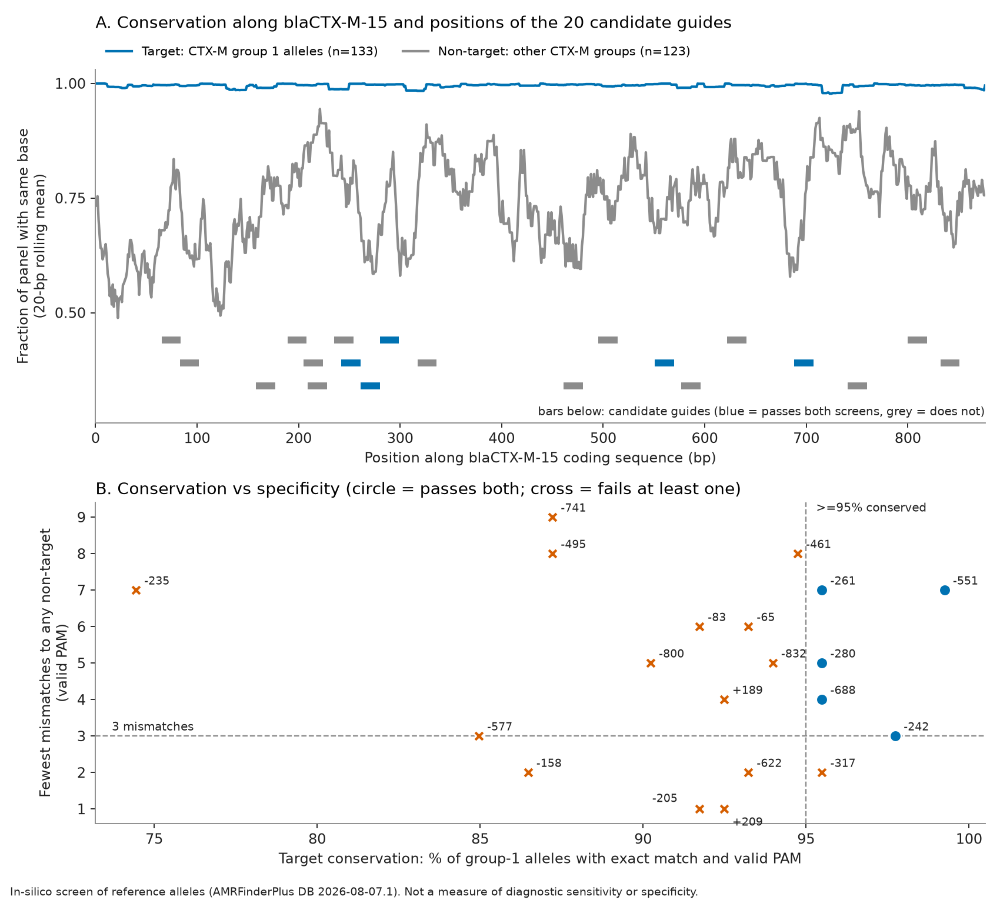

# CTX-M CRISPR Guide Screen

## What is this project about?

One of the challenges with antimicrobial susceptibility testing is time. In conventional culture-based testing, the organism has to grow before its response to different antibiotics can be assessed. This can take two to three days, sometimes longer.

I became interested in whether resistance could be detected much earlier, without waiting for the organism to grow. That led me to CRISPR-based diagnostics, which can detect specific DNA sequences and have the potential to deliver results much faster than conventional methods.

But detecting a gene with CRISPR is not simply a matter of knowing which gene to look for. The system needs a guide RNA (gRNA) that recognises a particular DNA sequence within the target. Choosing that sequence is what this project is about.

I focused on CTX-M-15, an ESBL gene associated with resistance to third-generation cephalosporins. It was also the most common CTX-M gene in my previous project, [E. coli AMR Genomics](https://github.com/Ekoche1/ecoli-amr-genomics).

The challenge was finding a sequence that was conserved across CTX-M group 1 but sufficiently different from other resistance genes to avoid unintended detection.

I screened candidate sequences within CTX-M-15 against published DNA sequences to examine two things:

- **Conservation:** How well does the target sequence match other CTX-M group 1 variants?
- **Specificity:** How well does it distinguish CTX-M group 1 from other related resistance genes?

I also checked the best candidates against 28 complete *E. coli* sequences from NCBI, to see whether they behave the same way in real plasmids and chromosomes.

This is an initial step towards developing a CRISPR-based detection approach for CTX-M.

**This is a computational study.** It uses public sequences only. It does not demonstrate laboratory performance, diagnostic sensitivity or specificity, or limit of detection. No confidential or hospital data were used.

## What was done (first milestone)

| Step | Script | Output |
|---|---|---|
| 1. Build allele panels from the NCBI AMRFinderPlus database (v2026-08-07.1) | `scripts/01_build_panels.py` | `data/panels/`, `data/MANIFEST.md` |
| 2. Enumerate 20 candidate guides, screen against all panels | `scripts/02_screen_guides.py` | `results/guide_summary.tsv`, `guide_vs_sequence.tsv` |
| 3. Independent re-computation with a different engine | `scripts/03_independent_check.py` | `results/independent_check.json` |
| 4. Figure | `scripts/04_make_figure.py` | `results/figure1_guide_screen.png` |
| 5. Genome pilot: 28 *E. coli* sequences | `scripts/05_genome_pilot.py` | `data/genomes_manifest.tsv`, `results/genome_pilot_*` |
| 6. Which alleles escape the passing guides | `scripts/06_allele_misses.py` | `results/passing_guides_*.tsv` |
| 7. Summary tables (also rewrites the table below from the results files) | `scripts/07_report_tables.py` | `results/passing_guides.md`, `results/genome_pilot_guide_summary.tsv` |

Panels: **133** target alleles (CTX-M group 1), **123** other-CTX-M-group alleles and **161**
alleles from other β-lactamase families as non-targets, and **11** hybrid/divergent CTX-M
alleles kept apart as "unassigned". One allele (CTX-M-161) was excluded for an ambiguous base.

## Results



**How to read this figure.** Panel A: along the CTX-M-15 gene, the blue line shows how similar the CTX-M group 1 variants are to each other. High is good, because a guide placed there matches all of them. The grey line shows how similar other CTX-M groups are to CTX-M-15. Low is good, because a guide placed there can tell them apart. Each bar below is one candidate guide, and blue bars passed both checks.

Panel B: each point is one candidate guide. Further right means it matches more CTX-M group 1 variants. Higher up means it differs more from the closest gene it should not detect. The 5 blue circles pass both checks.

- **Conservation.** Across the 133 group-1 alleles, the CTX-M-15 sequence is highly conserved:
  702 of 876 positions are identical in every allele (mean per-position conservation 99.5%).
  Other CTX-M groups share only about 74–76% identity with CTX-M-15.
- **Candidates.** The CTX-M-15 reference has 20 PAM-valid 20-nt candidates (2 on the + strand,
  18 on the − strand). Using criteria fixed before looking at the results, **6 were conserved**
  (exact match with a valid PAM in at least 95% of group-1 alleles), **15 were specific** (at least
  3 mismatches to every non-target allele), and **5 passed both**:

<!-- PASSING_TABLE_START -->
| Guide (strand, forward position) | PAM | Spacer 5'→3' (DNA) | GC | Group-1 alleles matched | Fewest mismatches to any non-target allele | Fewest mismatches in 14 gene-free chromosomes | Unassigned/hybrid alleles matched |
|---|---|---|---|---|---|---|---|
| -242 | TTTC | `ACTTTTCTTCAGCACCGCGG` | 0.55 | 130/133 (97.7%) | 3 | 6 | 4/11 |
| -261 | TTTA | `ACAGATTCGGTTCGCTTTCA` | 0.45 | 127/133 (95.5%) | 7 | 5 | 4/11 |
| -280 | TTTG | `ATCTCAACTCGCTGATTTAA` | 0.35 | 127/133 (95.5%) | 5 | 4 | 4/11 |
| -551 | TTTG | `CGCCATTGCCCGAGGTGAAG` | 0.65 | 132/133 (99.2%) | 7 | 5 | 0/11 |
| -688 | TTTA | `TCCCCCACAACCCAGGAAGC` | 0.65 | 127/133 (95.5%) | 4 | 5 | 6/11 |
<!-- PASSING_TABLE_END -->

- **Several pass only narrowly.** Guide −242 has exactly 3 mismatches to its closest non-target
  allele, the lowest allowed. Guides −261, −280 and −688 sit at 95.5% against the 95% cut-off
  (each misses 6 of 133 group-1 alleles), so a slightly different threshold would change the list.
- **Most misses are a single mismatch.** No group-1 allele escapes all five guides.
  Guide −551 misses only CTX-M-68. CTX-M-260 and CTX-M-68 are matched by only 2 of the 5.
  Whether a one-mismatch target is still cut cannot be answered here.
- **Trade-off.** Guide −551 is the most conserved but matches 0 of the 11 hybrid/divergent
  alleles, whereas −688 matches 6 of them.
- **Sites shared with other CTX-M groups.** Guides +209, −317 and −205 fail the specificity
  screen because other CTX-M alleles match them within 2 mismatches (122, 66 and 14 non-target
  sequences respectively; `results/guide_summary.tsv`, column `n_nontarget_le2mm`). They are
  unsuitable for group-1-only detection. A pan-CTX-M use was not evaluated.

### Genome pilot (28 sequences, all from NCBI)

| Set | n | CTX-M-15 found by sequence |
|---|---|---|
| Plasmids annotated with blaCTX-M-15 | 12 | 12 (100% identity) |
| Chromosomes returned by a "CTX-M-15" text search | 8 | **2** (JJ1887, Nord58) |
| Chromosomes returned by a "NOT CTX-M" search | 8 | 0 |

- **Annotation text was unreliable.** 6 of the 8 chromosomes that matched a CTX-M-15 text search
  contain no CTX-M gene at all (their feature tables show only AmpC, OXA-1 and similar genes).
  Presence was therefore decided by sequence, not by label. Those 6 were treated as gene-free.
- All 20 guides match exactly, with a valid PAM and in a single copy, in all 14 verified
  gene-positive sequences. **This is expected by construction**: every positive carries the
  identical CTX-M-15 allele, so it is not independent evidence of conservation.
- Across the 14 gene-free chromosomes there is **no exact hit** for any guide. The closest
  chromosomal hits for the 5 passing guides have 4 to 6 mismatches.

### Verification

- **34 tests pass.** Passing tests show the code does what it specifies; they do not validate
  the biology.
- **Independent check:** 17,120 guide × sequence comparisons recomputed with a different
  engine: **0 disagreements**. All 20 guide coordinates and PAMs, and the candidate count, were
  confirmed independently.

## Limitations

- Reference alleles are not isolates and are not weighted by clinical frequency.
- CTX-M-15 is a gene carried by several species, so a test for it detects the resistance gene, not *E. coli*.
- Mismatch counting treats all positions alike; real Cas12a tolerates mismatches far less in the
  PAM-proximal seed, and bulges are ignored. The results are a screen, not a prediction.
- No RPA/PCR primers were designed or evaluated, and no published CTX-M Cas12a assay was
  found (PubMed searches on 2026-10-12 returned none; this does not prove none exists).
- Not tested against the human genome, the microbiome, or non-*E. coli* species.
- The genome pilot is small; the 14 positives are all the same allele; none are known to be Nigerian or neonatal.
- Thresholds (≥95% conserved, ≥3 mismatches, identity 0.93 / lead 0.05 for grouping) are my choices.

## Reproduce

```powershell
py -3.12 -m venv .venv
.\.venv\Scripts\python.exe -m pip install -r requirements.txt
.\.venv\Scripts\python.exe -m pip install -e ".[dev]"
# data/raw/ is not committed; download the 3 AMRFinderPlus files listed in data/MANIFEST.md, check hashes
.\.venv\Scripts\python.exe scripts\01_build_panels.py
.\.venv\Scripts\python.exe scripts\02_screen_guides.py
.\.venv\Scripts\python.exe scripts\03_independent_check.py
.\.venv\Scripts\python.exe scripts\04_make_figure.py
.\.venv\Scripts\python.exe scripts\05_genome_pilot.py   # ~10 min, ~80 MB download
.\.venv\Scripts\python.exe scripts\06_allele_misses.py
.\.venv\Scripts\python.exe scripts\07_report_tables.py
.\.venv\Scripts\python.exe -m pytest
```

## Repository layout

- `src/ctxm_screen/`: study code (sequences, panels, guides, compare, conservation, genome)
- `scripts/`: the seven steps, numbered in the order they run
- `docs/METHODS.md`: the decisions behind each step, and why
- `data/`: panels, manifests, selection record; `results/`: tables, figure, run info
- `tests/`: the test suite

## Background

This project follows from my accepted ASLM 2025 abstract, *Strengthening AMR surveillance through CRISPR-based point-of-care diagnostics: in-silico design and validation for neonatal sepsis pathogens in Nigeria*. The abstract proposed four resistance genes. This project covers one of them, CTX-M-15, and screens candidate guide sequences only. It does not include any validation.

## Credits and licence

**Data.** The gene sequences come from the NCBI AMRFinderPlus database, version 2026-08-07.1. The complete *E. coli* sequences used in the genome check come from NCBI nuccore, and their accessions are listed in `data/genomes_manifest.tsv`.

> Feldgarden M, et al. (2021). AMRFinderPlus and the Reference Gene Catalog facilitate examination of the genomic links among antimicrobial resistance, stress response, and virulence. *Scientific Reports* 11: 12728. https://doi.org/10.1038/s41598-021-91456-0

**Licence.** The code in this repository is released under the MIT licence (see `LICENSE`).
